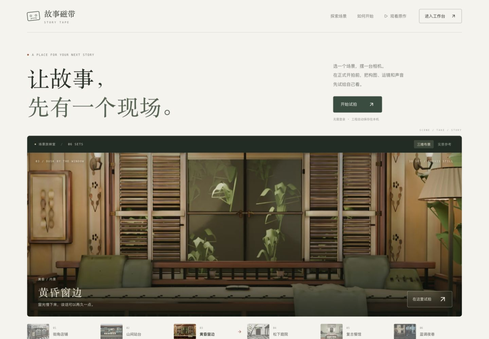
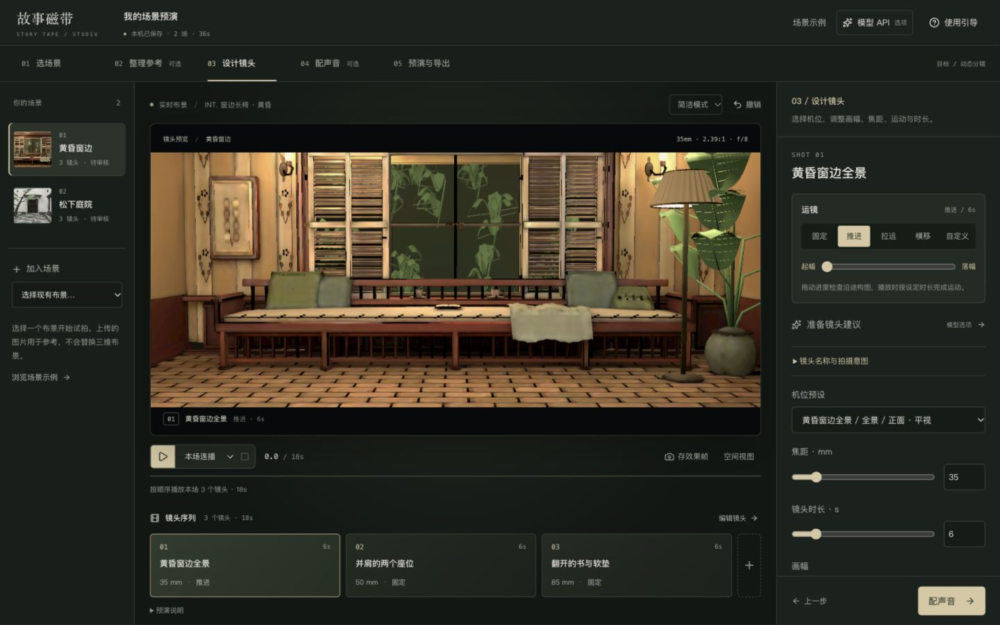
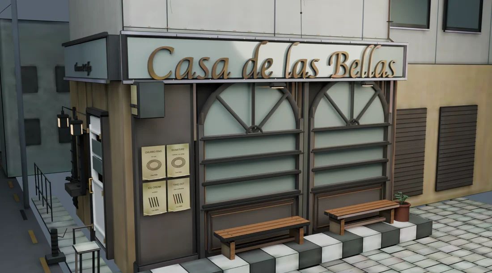
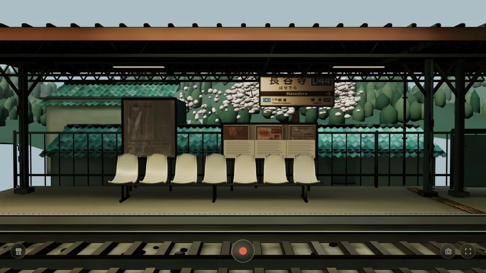
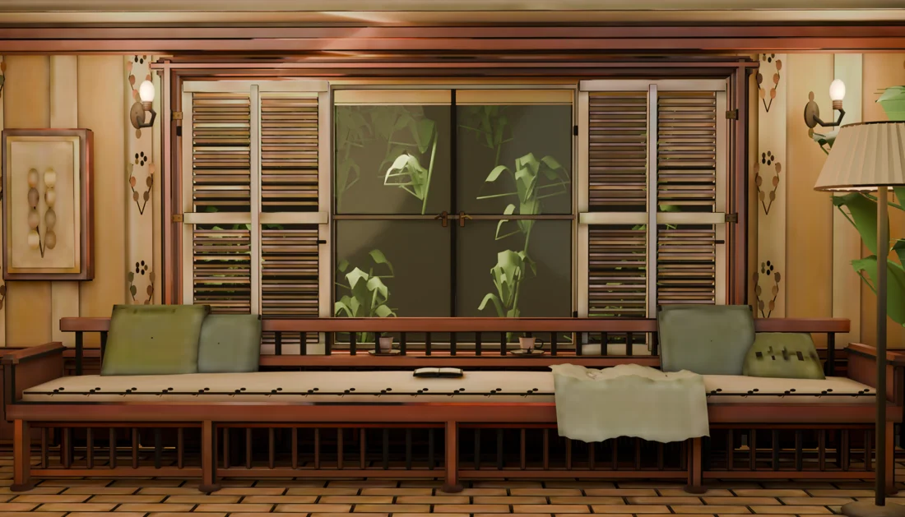
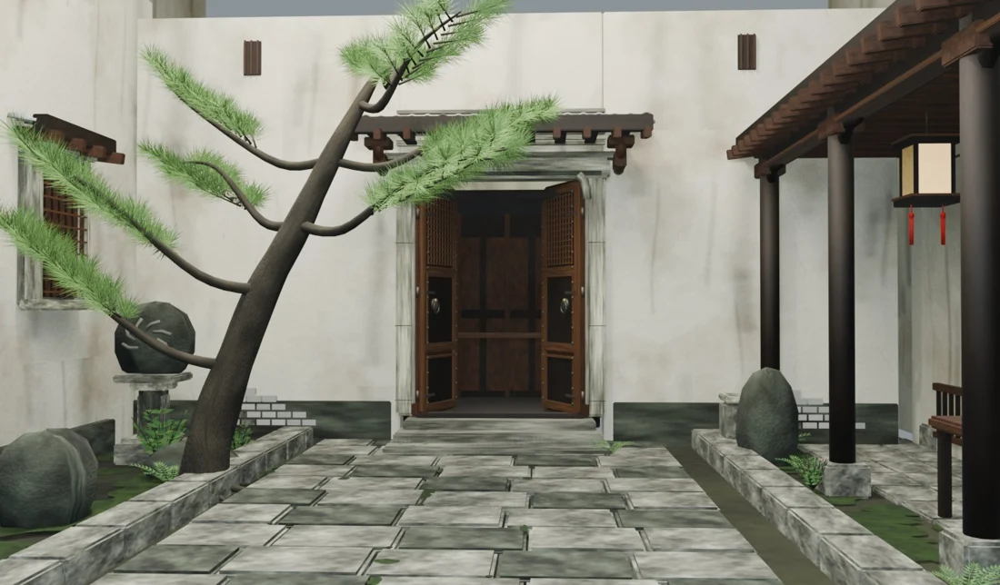
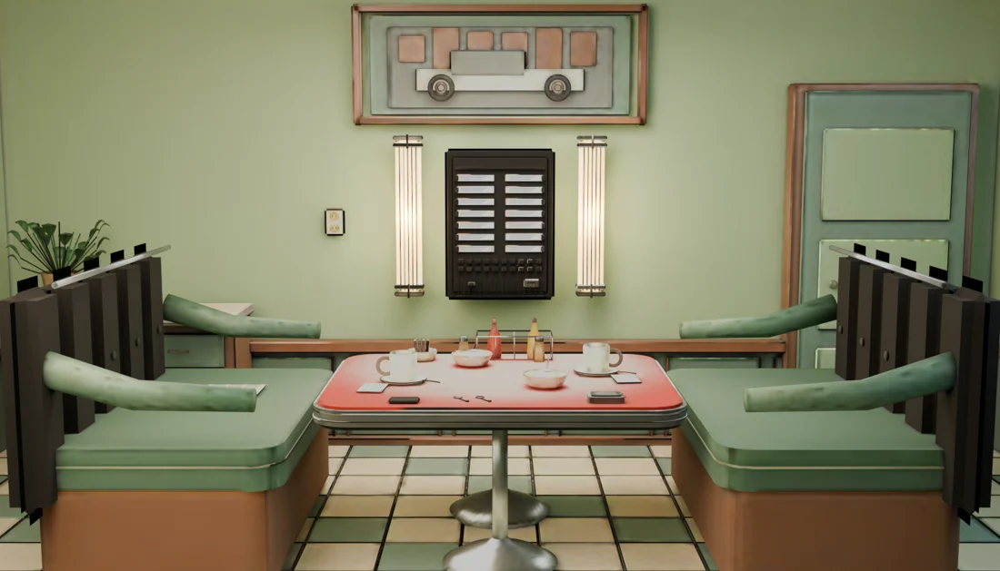
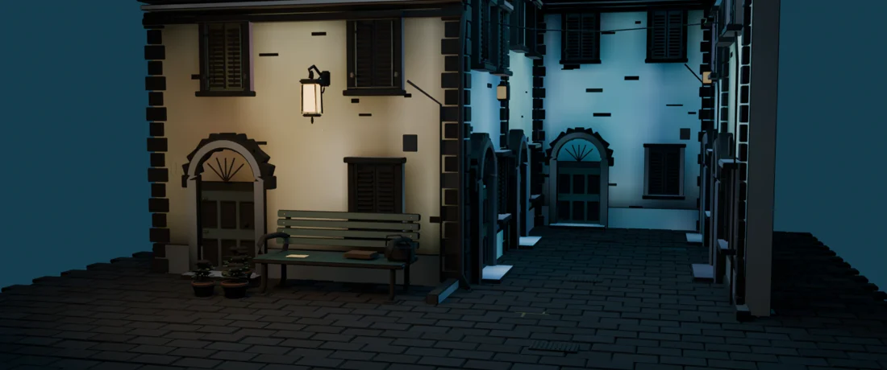

<div align="center">

# Story Tape

### Work out the shot before you shoot.

A browser-based scene design and shot previsualization demo for filmmakers.

**English** · [简体中文](README.zh-CN.md)

[Try the demo](https://casa-bellas-action.tb8zssvcd2.chatgpt.site/) · [Open the workbench](https://casa-bellas-action.tb8zssvcd2.chatgpt.site/previs?guide=1) · [Watch the interactive film](https://casa-bellas-action.tb8zssvcd2.chatgpt.site/film/) · [Product overview](docs/product-overview.md)

**Product prototype** &nbsp; / &nbsp; **6 reusable 3D sets** &nbsp; / &nbsp; **Plans · Frames · Animatics**

</div>

[](https://casa-bellas-action.tb8zssvcd2.chatgpt.site/)

Story Tape brings scene references, camera choices, movement, subtitles, and sound into one editable project. Explore a set, compare ways to shoot it, and share a scene plan, a still frame, or an animatic before production begins.

> **Current status:** A working application demo with authored 3D sets. The model-provider panel prepares configuration and task descriptions; it does **not** call generation APIs yet. Photo upload does **not** reconstruct a 3D scene. The application interface is primarily in Chinese; this repository provides English and Chinese introductions.

## See it in action



| Start here | What to try |
| --- | --- |
| [Scene gallery](https://casa-bellas-action.tb8zssvcd2.chatgpt.site/) | Browse six sets and compare rendered views with photographic references. |
| [Previs workbench](https://casa-bellas-action.tb8zssvcd2.chatgpt.site/previs?guide=1) | Follow the guide, choose a shot, try a camera move, and export a frame or animatic. |
| [Interactive film](https://casa-bellas-action.tb8zssvcd2.chatgpt.site/film/) | Drag a cassette into a 3D player, put on the headphones, and explore the scenes as tracks. |

**A first session:** Choose the station set → select a camera → try a slow push-in → compare the starting and ending frames → arrange sound → export a scene plan or a short animatic.

Playback offers **current shot**, **current scene**, and **whole project** scopes. A fixed shot stays fixed; choose a movement to see the camera travel. Desktop use is recommended for editing. Sound starts after a user interaction, and WebM export requires browser support for MediaRecorder.

## Why Story Tape?

A reference image communicates a mood. It cannot show what a moving camera will reveal, whether another angle preserves the space, or how a sound cue changes a shot's timing.

Story Tape explores that gap between inspiration and a shootable plan. Its focus is **editable creative decisions**: return to the same set, change the camera or timing, and compare the result. Three-dimensional space supports consistent viewpoints and occlusion; the intended deliverables remain scene plans, frames, and animatics.

The primary audience is independent filmmakers, directors, cinematographers, film students, and small production teams working on pre-production. A template-based path for less experienced creators is a future direction to validate.

## What you can do

| Capability | In the current demo |
| --- | --- |
| **Plan a scene** | Choose an authored set; record intent, constraints, references, and open questions; reorder scenes. |
| **Organize references** | Import local images and audio and label their role: space, materials, lighting, mood, music, or voice. |
| **Design a shot** | Use camera presets; adjust focal length, aspect ratio, duration, lighting preset, aperture, focus distance, and target. |
| **Rehearse movement** | Use a fixed camera, push-in, pull-out, lateral move, or custom start/end displacement; scrub through the move. |
| **Arrange sound** | Layer music, ambience, dialogue/voiceover, and event effects with timing, source in/out points, gain, and fades. |
| **Time an event** | Place the station's train-warning cue in a shot; the warning precedes the passing train. |
| **Compare and export** | Save frames with camera settings; export a plan, shot list, project JSON, or browser-rendered animatic. |

Current controls include **18–135 mm** focal lengths, **2–30 second** shots, and **2.39:1, 1.85:1, 16:9, 1:1, and 9:16** framing. These are previs controls, not calibrated measurements of a real camera or location.

## Six places to try a different shot

| Street-corner storefront | Mountain station | Window at dusk |
| :---: | :---: | :---: |
|  |  |  |
| Establishing shots, windows, and the bench outside. | Platform depth, waiting positions, and a passing train. | Window light, adjacent seats, and small details. |

| Pine courtyard | Retro diner | Blue-hour alley |
| :---: | :---: | :---: |
|  |  |  |
| Doorway framing, stone paths, and layered space. | Opposing seats and compositions across a table. | Warm practical light against a cool street. |

These are existing Blender-built sets, shown here as renders. Reference photography guided their construction; arbitrary image-to-3D generation is not implemented.

## Take a plan out of the workbench

- **Scene plan / shot list — Markdown:** intent, reference notes, shot order, and sound decisions.
- **Look frame — PNG:** a rendered view for comparing framing, lens settings, and light.
- **Animatic — WebM:** a 24 fps browser preview with shot subtitles and sound, up to 180 seconds per export. Performance depends on the browser and device.
- **Editable project — JSON:** scene and shot settings plus asset descriptions. Original local media files are not bundled in the JSON.

Previs projects and imported media are stored in the current browser using localStorage and IndexedDB. Moving to another device requires carrying the original media separately. The cloud story editor is a separate workflow; it does not automatically sync local previs projects.

## Run locally

Requires **Node.js 22.13 or newer** and npm.

```bash
git clone https://github.com/humanbean0410/story-tape.git
cd story-tape
npm ci
npm run dev
```

Open `http://localhost:5173` or the loopback address printed by the development server. Start with `/previs` for shot design or `/film/` for the interactive piece. No generative-model key is required to explore the existing sets.

```bash
npm run build
```

The full application targets **Sites / Cloudflare Workers**, with D1 and R2 for cloud story data and uploads. It is not a complete GitHub Pages deployment: authentication, cloud persistence, and publishing require host-specific bindings and migrations. See the [development guide](docs/development.md) for routes, architecture, checks, and deployment boundaries.

## Built from a film, shaped into a tool

This project began with a photograph of a Casa de las Bellas storefront and the idea of “Action.” A cassette player became the entrance to an interactive short: each location is a track, and camera positions reveal different parts of the same set.

Repeated changes to that piece exposed the product opportunity: make those choices reusable and editable. The workbench separates sets, cameras, movement, subtitles, and audio into project data. Read the [product overview](docs/product-overview.md) for the audience, workflow, design choices, and next questions to test.

## What comes next

Test the workbench with filmmakers planning one real scene and producing a plan, frames, and an animatic. Their revision and communication needs will guide work on reference-to-set preparation, template depth, asset generation, and camera controls.

Model-assisted reference analysis and asset generation, cross-device previs sync, collaboration, and character performance remain future work. There are no validated adoption or productivity claims in this demo.

## Feedback

[Report a bug or suggest an improvement](https://github.com/humanbean0410/story-tape/issues/new). For playback or export problems, include the scene, shot, browser, device, and steps to reproduce. For creative feedback, describe the shot you wanted and the control you were missing.

---

Created by [humanbean0410](https://github.com/humanbean0410). **Story Tape / 故事磁带** is an application prototype; the live demo continues to run at its original hosting address.
